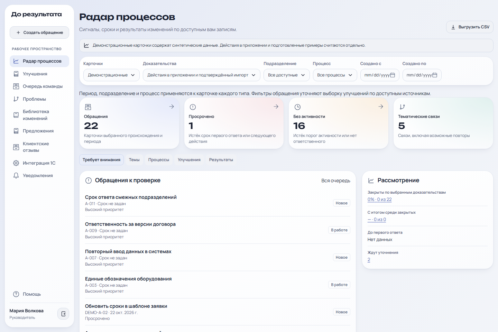
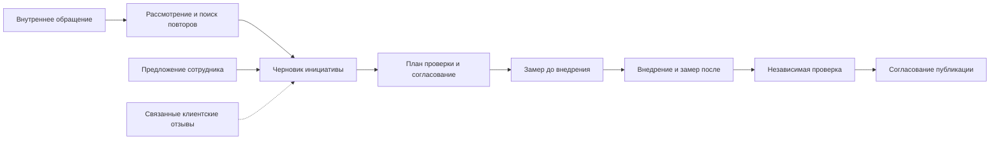

# До результата

**Внутренняя обратная связь и проверка рабочих улучшений**

Сотрудник сообщает о проблеме, предлагает улучшение или оставляет обратную связь. Команда рассматривает обращение, находит повторяющиеся сигналы и связывает их с инициативами. По инициативе заранее задают критерий успеха, сравнивают данные до и после внедрения и фиксируют результат отдельным решением.

[Локальный стенд](http://localhost:5173) · [Запуск в Docker](#запуск-в-docker) · [Демосценарий](#демосценарий) · [REST API](backend/docs/API.md)



[Все скриншоты текущей версии](frontend/docs/UX_SPEC.md#скриншоты)

## Возможности

| Раздел | Что можно сделать |
| --- | --- |
| **Обращения и очередь** | Подать обращение, назначить ответственного, запросить уточнение и зафиксировать решение. В очереди видны сроки и следующий шаг. |
| **Анонимный канал** | Отправить обращение без аккаунта, сохранить токен и вернуться к диалогу со спецочередью. Сообщения, итог и текстовые вложения UTF-8 до 64 КиБ хранятся в зашифрованном виде. |
| **Предложения сотрудников** | Обсуждать идеи внутри подразделения, голосовать и сортировать предложения по популярности. На пользователя приходится один голос. Ответственный может создать из предложения черновик инициативы. |
| **Радар и ИИ-помощник** | Искать похожие обращения и повторяющиеся темы. Groq предлагает категории, возможные дубликаты, группы обращений, гипотезы причин и KPI. Решение о применении принимает сотрудник. |
| **Клиентские отзывы** | Импортировать CSV, исключать дубли при повторной загрузке, искать похожие жалобы и связывать отзывы с внутренними обращениями и инициативами. |
| **Проверка эффекта** | Задать план измерений, собрать данные до и после внедрения, провести независимую проверку и отдельно согласовать публикацию результата. |
| **Интеграция с 1С** | Смотреть товары и остатки, создавать заявки, обновлять статусы и проверять журнал операций. Заявку можно привязать к инициативе. Повторная отправка использует тот же ключ идемпотентности. |

## От сигнала до результата



Итог проверки фиксирует, подтверждён ли эффект, достигнут ли он частично, не достигнут или данных недостаточно. В рабочем пространстве сотрудник видит свои обращения и опубликованные результаты. Обработчик ведёт очередь и инициативы в рамках выданных прав. Руководитель с нужными разрешениями согласует инициативы и проверяет результаты. Администратор управляет настройками, пользователями и мониторингом. Доступ к чувствительным обращениям зависит от разрешений и назначения в очередь. [Модель доступа](backend/docs/ACCESS_MODEL.md)

## Запуск в Docker

Установите Docker с Compose и выполните из корня репозитория:

```sh
docker compose -f backend/deploy/docker-compose.yml up -d --build --wait
```

Compose запускает PostgreSQL 17, применяет миграции, загружает демоданные и поднимает API, worker и веб-интерфейс. Откройте [localhost:5173](http://localhost:5173) и выберите демопрофиль. Для ручного входа адреса профилей указаны в [демосценарии](backend/docs/DEMO_SCRIPT.md). Пароль новой локальной установки — `Modus-Demo-2026!`. Для существующих аккаунтов действует пароль, заданный при создании.

| Адрес | Назначение |
| --- | --- |
| [localhost:5173](http://localhost:5173) | Рабочее пространство и демовход |
| [localhost:5173/anonymous](http://localhost:5173/anonymous) | Подача и отслеживание анонимного обращения |
| [Готовность API](http://localhost:5173/api/v1/health/ready) | Проверка соединения API с PostgreSQL через веб-прокси |
| [Swagger](http://localhost:4000/api/v1/docs) | Документация API в режиме разработки |

### Анонимный канал, Groq и 1С

Настройки Compose можно хранить в локальном `.env` в корне проекта. Файл исключён из Git.

| Переменные | Как включить |
| --- | --- |
| `ANONYMOUS_DATA_KEY` | Сгенерируйте 32 случайных байта в hex и сохраните значение. API и worker используют один ключ. Сохраняйте его между перезапусками, чтобы читать ранее зашифрованные диалоги. |
| `GROQ_AI_ENABLED`, `GROQ_API_KEY` | Задайте `GROQ_AI_ENABLED=true` и свой ключ. ИИ-анализ обычной внутренней карточки отправляется в Groq по запросу сотрудника. Анонимные и чувствительные карточки исключены из этого анализа. |
| `ONEC_MODE` | В локальном Docker по умолчанию выбран `simulator`. Он доступен демопрофилям обработки и использует демонстрационные товары, остатки и заявки. |
| `ONEC_MODE=http`, `ONEC_API_URL`, `ONEC_API_TOKEN` | Рабочий обмен требует опубликованного HTTP-сервиса вашей конфигурации 1С и разрешения `ONEC_OPERATOR` у сотрудника. |

Команда для генерации ключа анонимного канала:

```sh
node -e "console.log(require('node:crypto').randomBytes(32).toString('hex'))"
```

После изменения `.env` примените настройки. Если используете `backend/.env` для Compose, передайте его явно через `--env-file backend/.env`.

```sh
docker compose -f backend/deploy/docker-compose.yml up -d --wait
docker compose -f backend/deploy/docker-compose.yml ps -a
```

Контейнер `migrate` после успеха завершается с кодом 0. Обновление контейнеров через `up` сохраняет именованные тома базы и вложений. Для существующего стенда с другим именем проекта укажите то же имя через `-p`. [Эксплуатация и production](backend/docs/OPERATIONS.md) · [Контракт 1С](backend/docs/API.md#интеграция-с-1с)

## Демосценарий

1. **Сотрудник.** Создайте обычное обращение о задержке доставки. В разделе «Предложения» опубликуйте идею по улучшению доставки, оставьте комментарий и проголосуйте.
2. **Обработчик.** Найдите обращение в очереди, запросите уточнение и получите ответ. На доске предложений создайте из идеи инициативу. Задайте KPI «Доля опоздавших доставок» с целью 5%.
3. **Руководитель и обработчик.** Согласуйте инициативу, зафиксируйте учебное измерение 12% до внедрения и 4% за сопоставимый период после. Передайте карточку руководителю для проверки результата.
4. **Анонимный автор и спецочередь.** Отправьте обращение без входа, сохраните токен и откройте диалог. Под профилем «Спецочередь» запросите уточнение. Ответьте по токену и проверьте, что рассмотрение возобновилось.
5. **Клиентские отзывы и 1С.** Импортируйте пример ниже под обработчиком, найдите похожие отзывы и свяжите один с обращением и инициативой. Повторный импорт пропустит обе строки. Из инициативы создайте заявку на товар `DEMO-001`, затем обновите статус и откройте журнал.
6. **Groq.** При включённом провайдере создайте два похожих обычных обращения. В одном из них под обработчиком откройте «ИИ-помощник» → «Анализ обращения». Проверьте кандидатов, гипотезы и предложенные KPI перед подтверждением.

Пример файла `reviews.csv` в UTF-8:

```csv
date,title,body
2026-11-10,Курьер опоздал,Доставку задержали на два часа.
2026-11-11,Курьер снова опоздал,Доставку задержали на два часа.
```

Для показа с отдельными контейнерами и томами используйте [демостенд](docs/DEMO_RUNBOOK.md).

## Архитектура и разработка

| Каталог | Состав |
| --- | --- |
| [`frontend/`](frontend/README.md) | React, TypeScript, Vite, Nginx и сценарии Playwright |
| [`backend/`](backend/README.md) | NestJS REST API, Prisma, миграции PostgreSQL, worker и серверные тесты |
| [`backend/deploy/`](backend/deploy) | Docker Compose для локальной, демонстрационной и production-среды |
| [`.github/workflows/`](.github/workflows) | Проверки GitHub Actions |

API проверяет сессию и права на стороне сервера. PostgreSQL хранит обращения, инициативы, измерения и аудит. Worker обслуживает очередь уведомлений, напоминания и повторные попытки маршрутизации.

Для запуска без Docker-образов приложений нужны Node.js 24 и pnpm 11.25.0. Поднимите PostgreSQL через `docker compose -f backend/deploy/docker-compose.yml up -d postgres` или используйте свой PostgreSQL 17. В `backend/` скопируйте `.env.example` в `.env`, проверьте `DATABASE_URL` и выполните:

```sh
pnpm install --frozen-lockfile
pnpm db:migrate
pnpm db:seed
pnpm dev
```

В отдельном терминале запустите `pnpm worker` из `backend/`. В `frontend/` выполните `pnpm install --frozen-lockfile` и `pnpm dev`. Vite слушает порт 5173 и проксирует `/api` на порт 4000. При смене `VITE_PORT` задайте соответствующий `WEB_ORIGIN` в backend. Адрес API для прокси задаёт `MODUS_API_TARGET`.

## Проверки

```sh
pnpm -C backend lint
pnpm -C backend typecheck
pnpm -C backend build
pnpm -C backend test
pnpm -C frontend lint
pnpm -C frontend build
```

Интеграционные тесты запускаются командой `pnpm -C backend test:integration` с `TEST_DATABASE_URL`. Браузерные — командой `pnpm -C frontend test:e2e` с `E2E_DATABASE_URL` либо `E2E_BASE_URL` для отдельного стенда. Полный браузерный прогон использует [SQL-фикстуры](frontend/tests/ux-fixtures.sql) и `UX_FIXTURES=true`. Эти сценарии создают записи, поэтому используйте отдельную тестовую базу. [Подготовка баз и запуск тестов](backend/docs/TEST_PLAN.md)

В последнем полном прогоне прошли **9 модульных, 29 интеграционных и 22 браузерных теста**. Groq дополнительно проверен реальными запросами на синтетических карточках. Режим 1С проверен в симуляторе, а HTTP-адаптер — на локальном сервере по контракту, включая повтор после обрыва связи. Обмен с конкретной рабочей конфигурацией 1С проверяется после подключения её HTTP-сервиса.

[Архитектура](backend/docs/ARCHITECTURE.md) · [Безопасность](backend/docs/SECURITY.md) · [Документация проекта](backend/docs/README.md)
