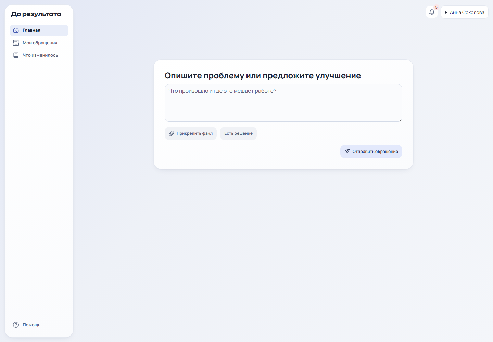
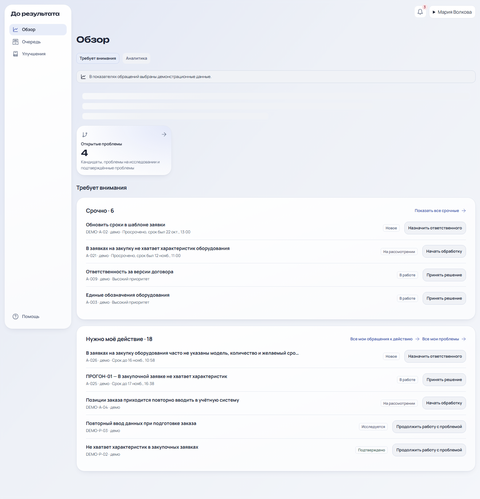
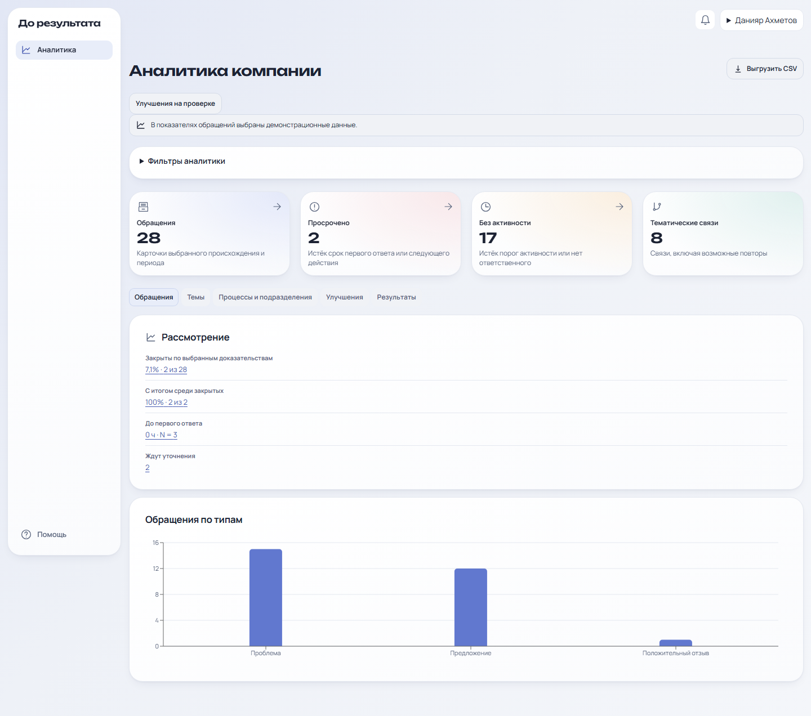
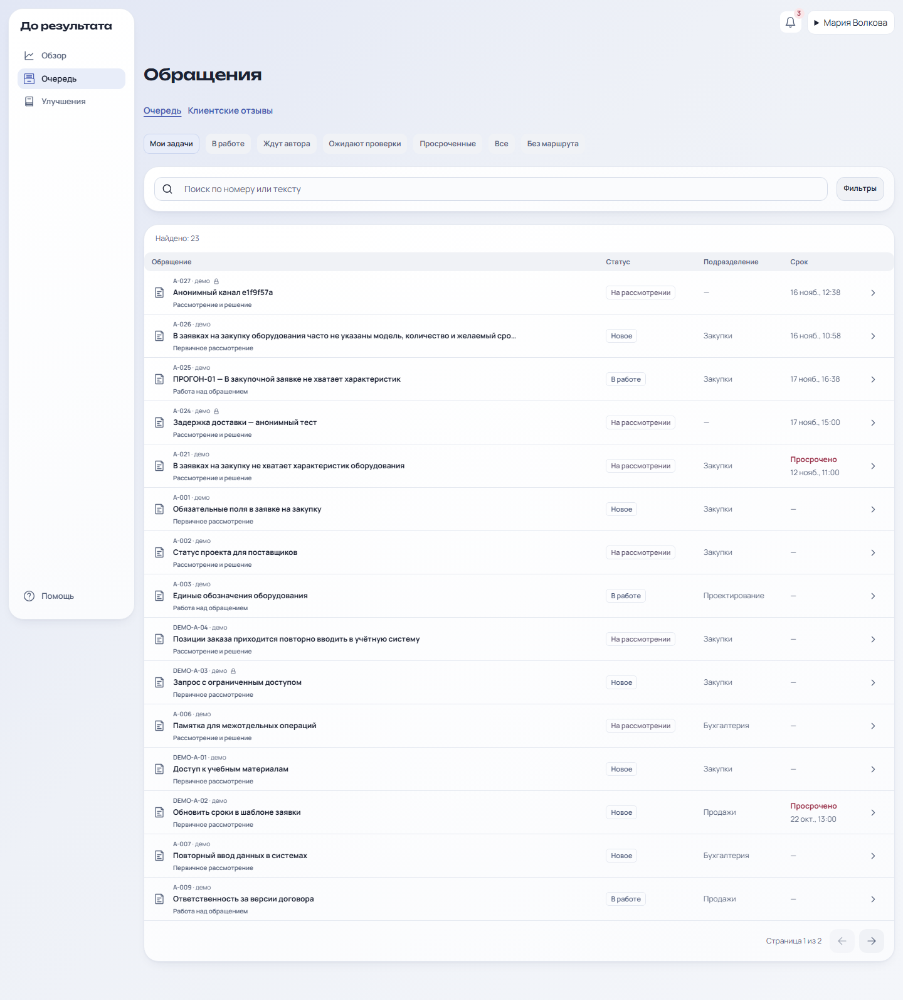
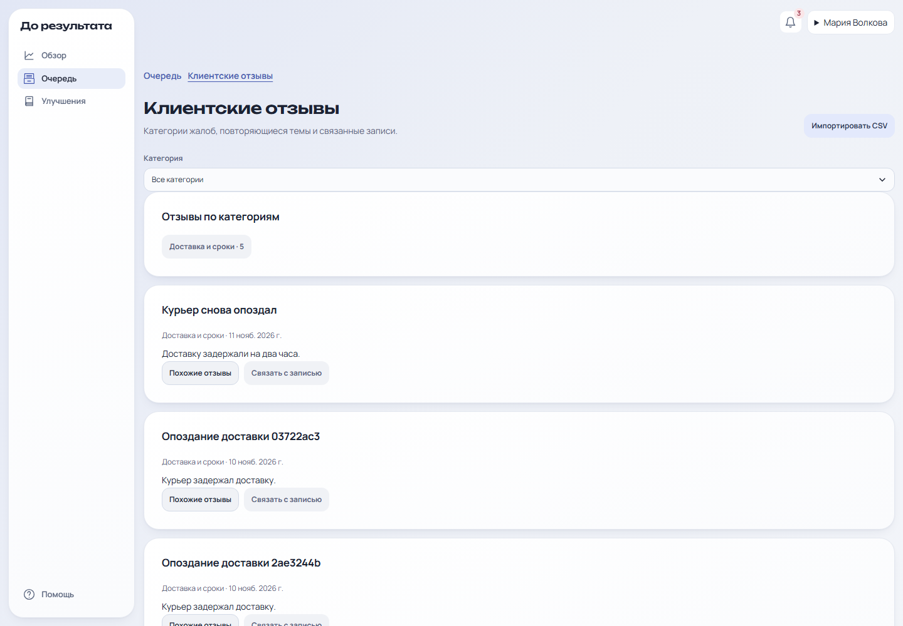
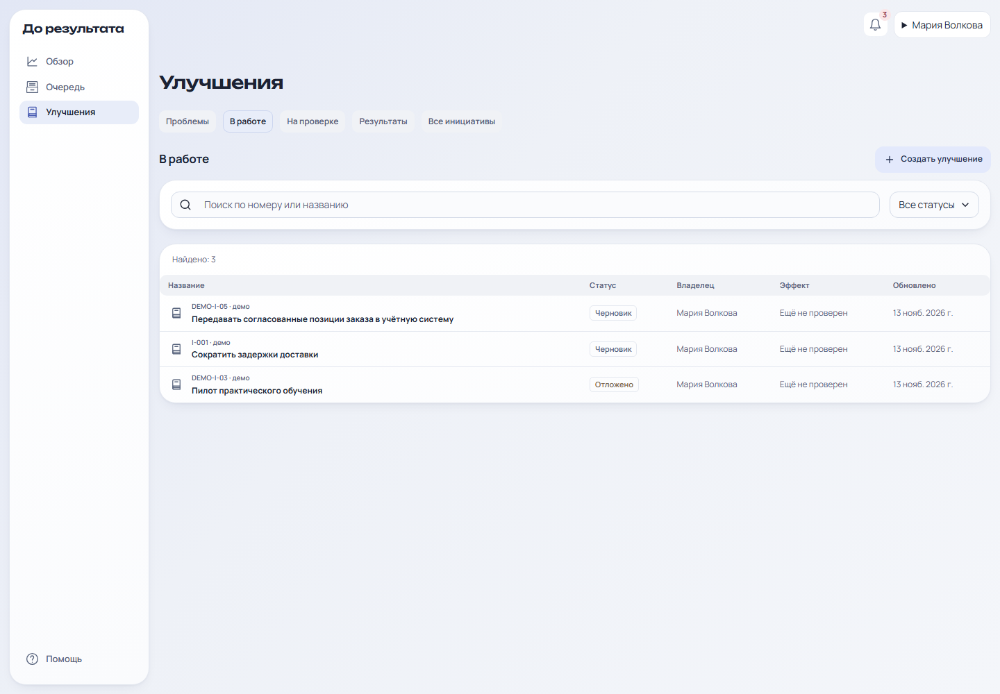
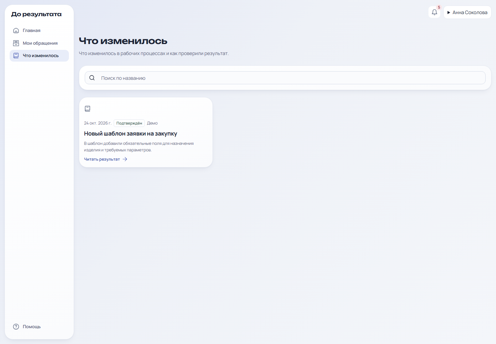
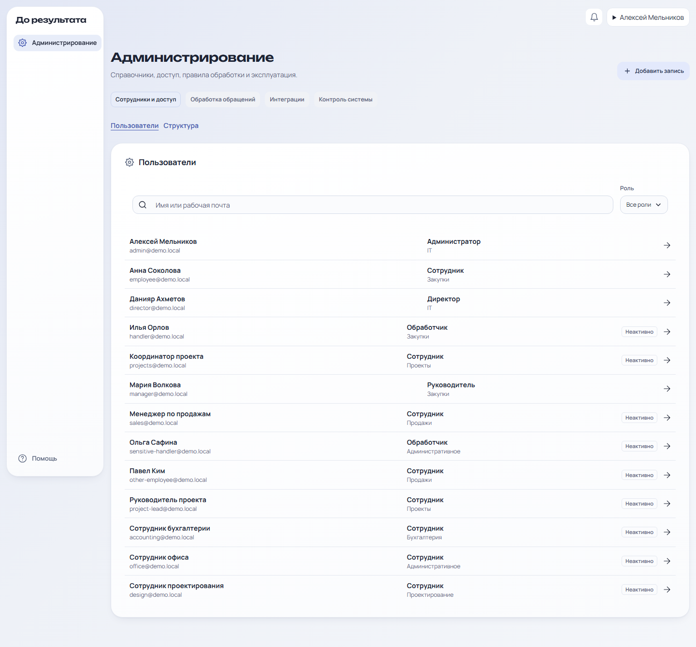

# До результата

[](https://react.dev/) [](https://www.typescriptlang.org/) [](https://nestjs.com/) [](https://www.postgresql.org/) [](https://docs.docker.com/compose/)

**Внутренняя обратная связь, обработка проблем и улучшений с проверкой эффекта по данным.**

Сотрудник сообщает о том, что мешает работе, следит за обращением и видит итог. Руководитель рассматривает обращения и повторяющиеся темы, запускает улучшения. Команда фиксирует ожидаемый результат, сравнивает показатели до и после внедрения и публикует проверенный итог.

## Содержание

[Возможности](#возможности) · [Роли](#роли) · [Интерфейс](#интерфейс) · [Запуск](#быстрый-запуск) · [Настройка](#настройка) · [Разработка](#разработка-и-проверки) · [Структура](#структура-проекта)

## Возможности

- **Обращения сотрудников.** Подача проблемы или предложения, вложения, статус, очередь, сроки, переписка с автором, служебные заметки, уточнения и решение с объяснением.
- **Анонимный канал.** Гость отправляет обращение и вложение, получает токен и возвращается к переписке. Содержимое анонимного канала шифруется. Для работы требуется постоянный `ANONYMOUS_DATA_KEY`.
- **Обработка очереди.** Назначение ответственного, передача, изменение срока, смена статуса, резервная маршрутизация и уведомления.
- **Предложения подразделения.** Сотрудники создают идеи, обсуждают и поддерживают их. Идею можно преобразовать в черновик улучшения.
- **Радар и аналитика.** Сводки по обращениям и срокам, просроченные и неактивные записи, темы и повторы, процессы и подразделения, улучшения и результаты. Роли с соответствующими правами могут выгрузить CSV.
- **Похожие обращения.** Система предлагает возможные связи. Их можно просмотреть и подтвердить или отклонить.
- **Улучшения и эффект.** Связь с проблемами и исходными обращениями, цель и план измерений, задачи и владельцы, наблюдения до и после, отдельная проверка результата, пересмотр заключения и обратная связь сотрудников.
- **Публикации «Что изменилось».** Описание изменения, способ проверки, результат и ограничения. Приглашённые авторы обращений могут оценить эффект.
- **Клиентские отзывы.** Импорт CSV с проверкой повторной загрузки, поиск похожих отзывов и связь с обращениями и улучшениями.
- **ИИ-подсказки Groq.** По запросу доступны помощь с разбором обращения и анализом улучшения. Перед отправкой данных сервис показывает предупреждение и запрашивает действие пользователя. Ручная работа доступна без ключа. В демонстрационном Compose Groq выключен.
- **Администрирование.** Пользователи и роли, подразделения, категории, процессы, очереди, правила маршрутизации и сроки, настройки Groq, мониторинг фоновых задач и аудит.
- **Уведомления.** Список событий и настройки уведомлений.

> Демо-записи и подготовленные примеры служат для показа и не являются производственными показателями.

## Роли

| Роль | Основные разделы |
| --- | --- |
| **Сотрудник** | Главная, мои обращения, предложения подразделения, что изменилось, уведомления |
| **Руководитель** | Обзор, очередь и обращения, клиентские отзывы, улучшения |
| **Директор** | Аналитика компании и проверка результатов улучшений |
| **Администратор** | Пользователи, структура, справочники, очереди, маршрутизация, сроки и состояние системы |

На локальном демонстрационном стенде доступны демопрофили. Также предусмотрен вход по рабочей почте и паролю.

## Интерфейс

### Главная сотрудника



### Обзор и аналитика

| Обзор руководителя | Аналитика директора |
| --- | --- |
|  |  |

### Очередь и клиентские отзывы

| Очередь обращений | Клиентские отзывы |
| --- | --- |
|  |  |

### Улучшения и публикации

| Улучшения | Что изменилось |
| --- | --- |
|  |  |

### Администрирование



## Быстрый запуск

Нужен Docker с Compose. Из корня репозитория выполните:

```sh
docker compose -f backend/deploy/docker-compose.yml up -d --build --wait
```

Откройте [http://localhost:5173](http://localhost:5173). API доступен на порту `4000`.

```sh
docker compose -f backend/deploy/docker-compose.yml ps
docker compose -f backend/deploy/docker-compose.yml down
```

## Настройка

Compose использует демонстрационные профили и локальную PostgreSQL. Для анонимного канала задайте в корневом `.env` `ANONYMOUS_DATA_KEY` со значением из 32 случайных байт в hex. Один ключ нужен API и worker. Сохраняйте его при перезапусках, чтобы читать существующие анонимные диалоги.

```sh
node -e "console.log(require('node:crypto').randomBytes(32).toString('hex'))"
```

Для ИИ-подсказок задайте `GROQ_AI_ENABLED=true` и `GROQ_API_KEY`. В локальном Compose Groq выключен по умолчанию. Демонстрационные настройки Compose не предназначены для production.

## Технологии

- **Frontend:** React 19, TypeScript, Vite, React Router, TanStack Query, Radix UI, Recharts.
- **Backend:** NestJS 11, TypeScript, Prisma 6, PostgreSQL 17.
- **Фоновые задачи:** отдельный Node.js worker.
- **Файлы:** локальное хранилище вложений и проверка загружаемых файлов.
- **Инфраструктура:** Docker Compose, Nginx, GitHub Actions.
- **Проверки:** ESLint, TypeScript, Node test runner, Playwright.

## Разработка и проверки

Требуются Node.js 24, pnpm 11.25.0 и PostgreSQL 17. Для локального backend скопируйте `backend/.env.example` в `backend/.env` и настройте `DATABASE_URL`.

```sh
pnpm -C backend install --frozen-lockfile
pnpm -C frontend install --frozen-lockfile
pnpm -C backend db:migrate
pnpm -C backend db:seed
```

```sh
pnpm -C backend lint
pnpm -C backend typecheck
pnpm -C backend test
pnpm -C backend build
pnpm -C frontend lint
pnpm -C frontend typecheck
pnpm -C frontend build
```

Интеграционные тесты требуют выделенную PostgreSQL через `TEST_DATABASE_URL`. Playwright запускается с тестовой базой или стендом, заданным в `E2E_BASE_URL`. Не используйте для проверок рабочую базу.

## Структура проекта

- `frontend/` — React-приложение и браузерные проверки.
- `backend/src/` — API, проверка доступа, маршрутизация, аналитика и worker.
- `backend/prisma/` — схема данных, миграции и демоданные.
- `backend/deploy/` — Docker Compose.
- `.github/workflows/` — автоматические проверки CI.
