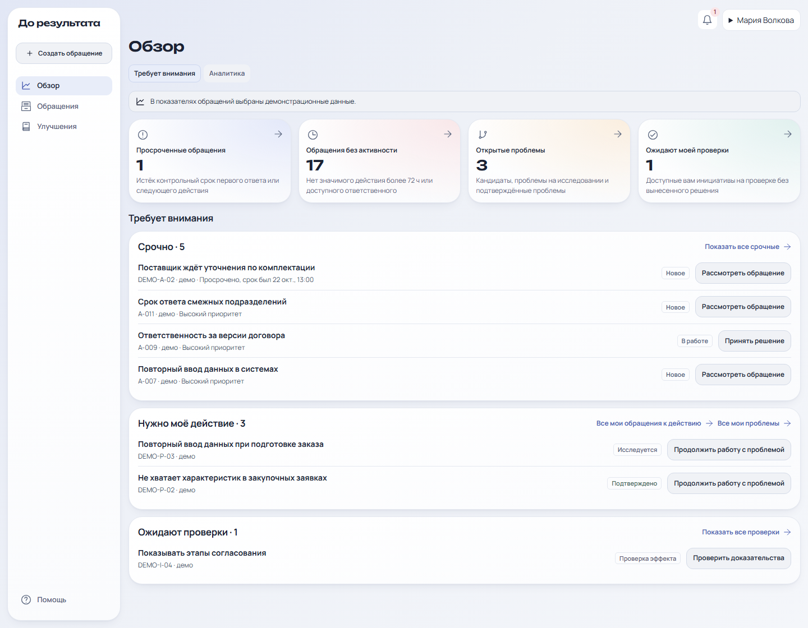
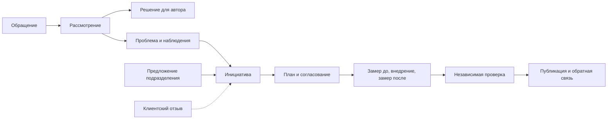
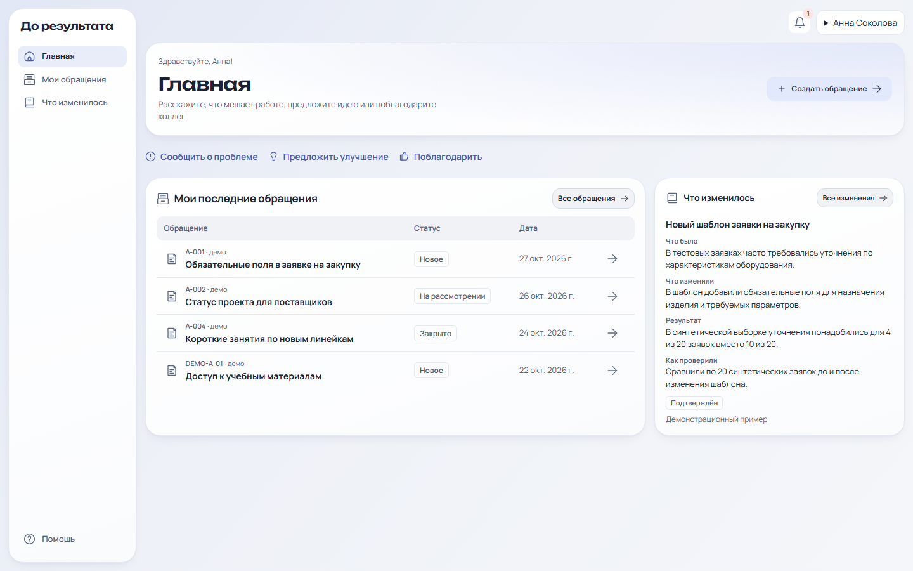
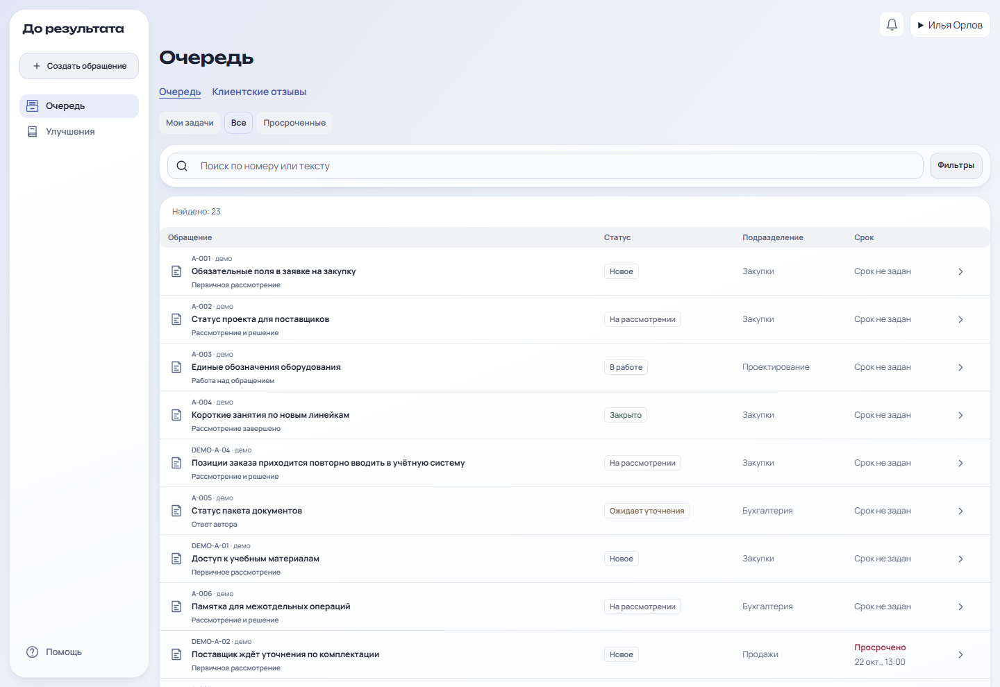
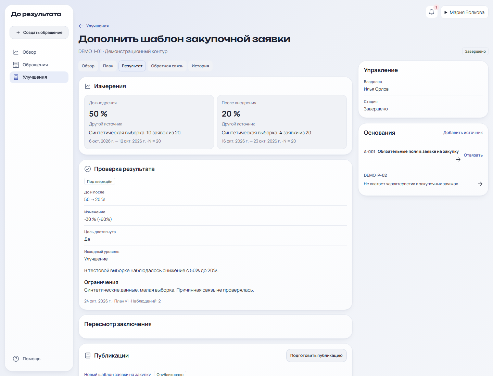
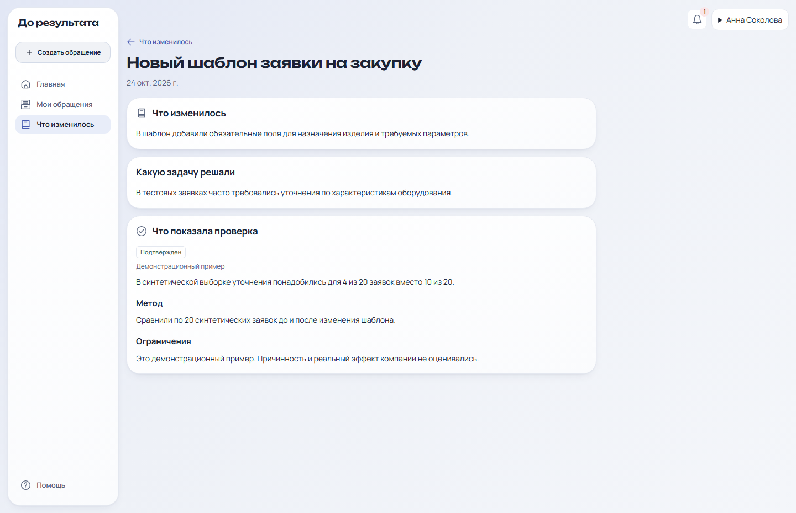
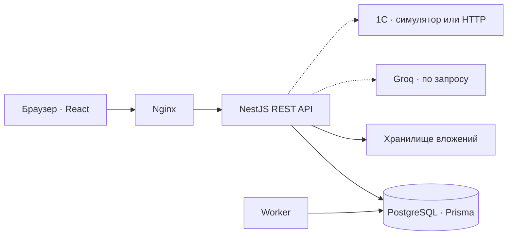

# Модус · Контур — «До результата»

**Внутренняя обратная связь, рабочие улучшения и проверка их эффекта.**

Сотрудник сообщает о проблеме и видит, кто её рассматривает и чем всё закончилось. Если проблема повторяется, команда связывает обращения, исследует причину и запускает улучшение. Руководитель заранее согласует критерий успеха, а результат проверяется по данным до и после внедрения. Сотрудники видят опубликованный итог в разделе «Что изменилось».

[Быстрый запуск](#быстрый-запуск) · [Демосценарий](#демосценарий) · [Скриншоты](#интерфейс) · [Архитектура](#архитектура) · [REST API](backend/docs/API.md)



*Обзор руководителя показывает срочные обращения, доступные действия и инициативы, которые можно независимо проверить. На скриншотах используются демонстрационные данные.*

## Зачем нужен «До результата»

| Что происходит в работе | Как это обрабатывает «До результата» |
| --- | --- |
| Сотрудник рассказал о проблеме и не знает, кто её рассматривает | Обращение получает номер, очередь и контрольный срок. Автор видит статус, переписку и обоснование решения. |
| Похожие замечания приходят от разных сотрудников | Обработчик сравнивает исходные записи и связывает их с исследуемой проблемой. Тематические связи можно подтвердить после просмотра источников. |
| Команда изменила процесс и хочет понять, помогло ли это | В инициативе сохраняются критерий успеха, задачи, измерения и отдельное заключение проверяющего. |
| Сотрудники хотят узнать, что поменялось | В публикации объясняются изменение, метод проверки и ограничения. Авторы исходных обращений могут оценить, помогло ли оно в работе. |

## Как проходит улучшение



**Обращение** описывает конкретную ситуацию. **Проблема** объединяет наблюдения, которые стоит исследовать. **Инициатива** фиксирует изменение и способ проверить его эффект. Обращение может завершиться пояснением или решением, а инициатива — подтверждённым, частичным, недостигнутым результатом либо заключением «Недостаточно данных».

## Возможности и роли

| Роль | Основные разделы | Что можно проверить |
| --- | --- | --- |
| **Сотрудник** | Главная, Мои обращения, Что изменилось | Подать обращение с вложением, ответить на уточнение, увидеть итог, обсудить предложение подразделения и оценить опубликованное изменение. |
| **Обработчик** | Очередь, Улучшения | Найти обращение, назначить ответственного, вести диалог и служебные заметки, исследовать проблему, подготовить и внедрить улучшение. |
| **Руководитель** | Обзор, Обращения, Улучшения | Открыть рабочие выборки из показателей, посмотреть аналитику и выгрузить CSV. При наличии полномочий согласовать инициативу, проверить эффект и опубликовать результат. |
| **Администратор** | Сотрудники и доступ, Обработка обращений, Интеграции, Контроль системы | Настроить пользователей, справочники, маршруты и сроки, проверить маршрут до создания обращения, посмотреть аудит и состояние worker. |

Проверка результата — полномочие в рабочей области. Владелец инициативы не проверяет собственный результат. Доступ к чувствительным обращениям определяется классом доступа и назначением в очередь. [Модель доступа](backend/docs/ACCESS_MODEL.md)

- **Анонимный канал.** Гость отправляет сообщение и TXT-вложение, получает токен и возвращается по нему в диалог. Сообщения, итог и текстовые вложения защищены шифрованием. [Безопасность](backend/docs/SECURITY.md)
- **Предложения подразделения.** Сотрудники обсуждают и поддерживают идеи. Ответственный может преобразовать предложение в черновик инициативы.
- **Клиентские отзывы.** Импорт CSV распознаёт повторную загрузку. Отзывы можно сравнивать и связывать с обращениями и инициативами.
- **ИИ-помощник.** Groq может предложить заголовок, категорию, возможные повторы, гипотезы и показатели. Применение подсказок подтверждает сотрудник. Подача и обработка доступны в ручном режиме. [Возможности Groq](backend/docs/GROQ_AI.md)
- **1С.** Товары, остатки, заявки и журнал операций доступны через симулятор либо настроенный HTTP-сервис. Заявка может быть связана с инициативой. [Контракт 1С](backend/docs/API.md#интеграция-с-1с)

## Интерфейс

| Главная сотрудника | Очередь обработчика |
| --- | --- |
| [](frontend/docs/screenshots/home-desktop.png) | [](frontend/docs/screenshots/queue.png) |
| Сотрудник выбирает тип обращения и видит последние изменения. | Обработчик ищет карточку, смотрит статус и контрольный срок. |
| **Проверка эффекта** | **Публикация результата** |
| [](frontend/docs/screenshots/result.png) | [](frontend/docs/screenshots/publication.png) |
| В карточке показаны замеры, цель и вывод независимой проверки. | Сотруднику доступны описание изменения, метод и ограничения. |

[Мобильная главная](frontend/docs/screenshots/home-mobile.png) · [Аналитика](frontend/docs/screenshots/radar.png) · [Предпросмотр маршрута](frontend/docs/screenshots/admin.png) · [Полная галерея](frontend/docs/UX_SPEC.md#скриншоты)

## Быстрый запуск

Нужен Docker с Compose. В корне репозитория выполните:

```sh
docker compose -f backend/deploy/docker-compose.yml up -d --build --wait
```

Compose поднимет PostgreSQL, применит миграции, загрузит демоданные и запустит API, worker и веб-интерфейс. Откройте [http://localhost:5173](http://localhost:5173), раскройте **Попробовать демоверсию** и выберите профиль.

| Профиль | Почта для ручного входа |
| --- | --- |
| Сотрудник | `employee@demo.local` |
| Обработчик | `handler@demo.local` |
| Руководитель | `manager@demo.local` |
| Администратор → в меню «Другие сценарии» | `admin@demo.local` |
| Другой сотрудник → в меню «Другие сценарии» | `other-employee@demo.local` |
| Спецочередь → в меню «Другие сценарии» | `sensitive-handler@demo.local` |

Пароль свежих демоаккаунтов — `Modus-Demo-2026!`. Для одновременной работы под разными ролями используйте отдельные профили браузера.

[Готовность API](http://localhost:5173/api/v1/health/ready) · [Swagger в режиме разработки](http://localhost:4000/api/v1/docs) · [Отдельный демостенд на порту 55531](docs/DEMO_RUNBOOK.md)

### Настройки локального стенда

| Переменная в локальном `.env` | Для чего нужна |
| --- | --- |
| `ANONYMOUS_DATA_KEY` | 32 случайных байта в hex для анонимного канала. Один ключ используют API и worker. Сохраняйте его между перезапусками для доступа к существующим диалогам. |
| `GROQ_AI_ENABLED`, `GROQ_API_KEY` | Для включения Groq задайте `GROQ_AI_ENABLED=true` и ключ. Конфиденциальные и анонимные карточки исключены из отправки провайдеру. |
| `ONEC_MODE` | Локальный Compose по умолчанию использует `simulator`. Для рабочего обмена задайте `http`, `ONEC_API_URL` и `ONEC_API_TOKEN`, затем выдайте операторам полномочие «Обмен с 1С». |
| `APPEAL_STALE_HOURS` | Порог значимой активности для обзора. По умолчанию 72 часа. |

Для генерации ключа анонимного канала при наличии Node.js:

```sh
node -e "console.log(require('node:crypto').randomBytes(32).toString('hex'))"
```

Добавьте значение в локальный `.env` в корне и повторите `docker compose -f backend/deploy/docker-compose.yml up -d --wait`. Проверьте состояние через `docker compose -f backend/deploy/docker-compose.yml ps -a`. Контейнер `migrate` после успешного запуска завершается с кодом 0. Если Compose получает переменные из другого файла, передайте его через `--env-file`. [Эксплуатация и production](backend/docs/OPERATIONS.md)

## Демосценарий

**Показ за 5 минут.** Используйте подготовленные карточки и переключайтесь между тремя профилями.

1. **Сотрудник → Главная → Сообщить о проблеме.** Введите «В заявке на закупку не хватает модели и срока поставки». Продолжите, оставьте категорию пустой и отправьте. Сохраните номер.
2. **Обработчик → Очередь → Все.** Найдите номер, проверьте резервный маршрут и возьмите карточку на рассмотрение. Запросите уточнение «Каких полей чаще всего не хватает?». Вернитесь в профиль сотрудника и ответьте через уведомление.
3. **Руководитель → Обзор.** Откройте пример `DEMO-A-02` в «Срочно» и `DEMO-I-04` в «Ожидают проверки». Кнопка «Проверить доказательства» ведёт прямо к результату.
4. **Руководитель → Улучшения → Все инициативы.** Найдите `DEMO-I-01` и `DEMO-I-02`. В первом примере доля возвратов снизилась с 50% до 20% в учебной выборке. Во втором данных для вывода недостаточно.
5. **Сотрудник → Что изменилось.** Откройте «Новый шаблон заявки на закупку» и посмотрите, что изменили, как проверили и какие ограничения указали.

Для полной проверки пройдите 13 блоков по ролям. В руководстве есть готовые тексты, измерения, отрицательные проверки прав и подсказки по переключению профилей. Используйте адрес своего локального стенда, если он отличается от адреса в руководстве. [Полный сценарий](docs/DEMO_ACCEPTANCE.md) · [TXT для вложения](docs/demo/demo-evidence.txt) · [CSV для импорта](docs/demo/demo-reviews.csv)

## Архитектура



| Где искать | Что находится внутри |
| --- | --- |
| [frontend](frontend/README.md) | React, TypeScript, Vite, интерфейс и браузерные проверки Playwright. |
| [backend](backend/README.md) | NestJS, Prisma, миграции, worker и серверные тесты. |
| [backend/deploy](backend/deploy) | Docker Compose для локального запуска, демо и production. |
| [GitHub Actions](.github/workflows/ci.yml) | Линтинг, типы, сборки, проверки Compose, серверные, нагрузочные и браузерные тесты. |

API проверяет права и допустимые переходы. PostgreSQL хранит данные и аудит. Worker доставляет уведомления, отправляет напоминания и повторяет маршрутизацию ожидающих обращений. [Архитектура](backend/docs/ARCHITECTURE.md) · [Модель данных](backend/docs/DATA_MODEL.md) · [Состояния и переходы](backend/docs/STATE_MACHINES.md)

## Разработка и проверки

Для разработки без контейнеров приложений нужны Node.js 24, pnpm 11.25.0 и PostgreSQL 17. Базу можно запустить отдельно:

```sh
docker compose -f backend/deploy/docker-compose.yml up -d postgres
```

Скопируйте `backend/.env.example` в `backend/.env` и проверьте `DATABASE_URL`. Из корня установите зависимости, примените миграции и загрузите данные:

```sh
pnpm -C backend install --frozen-lockfile
pnpm -C frontend install --frozen-lockfile
pnpm -C backend db:migrate
pnpm -C backend db:seed
```

В отдельных терминалах запустите `pnpm -C backend dev`, `pnpm -C backend worker` и `pnpm -C frontend dev`. Vite по умолчанию проксирует `/api` с порта 5173 на 4000. Если меняете порт Vite, укажите новый `WEB_ORIGIN` на сервере. Адрес API для прокси задаёт `MODUS_API_TARGET`.

| Проверка | Команды |
| --- | --- |
| Линтинг, типы и сборка | `pnpm -C backend lint`, `pnpm -C backend typecheck`, `pnpm -C backend build` и те же команды с `-C frontend`. |
| Модульные | `pnpm -C backend test`. |
| Интеграционные | `pnpm -C backend test:integration` с отдельной PostgreSQL через `TEST_DATABASE_URL`. |
| Браузерные | `pnpm -C frontend exec playwright install chromium`, затем `pnpm -C frontend test:e2e` с `E2E_DATABASE_URL` или `E2E_BASE_URL`. Для полного прогона подготовьте [SQL-фикстуры](frontend/tests/ux-fixtures.sql) и задайте `UX_FIXTURES=true`. |

Интеграционные и браузерные сценарии изменяют данные. Используйте выделенные базы. Рабочий HTTP-обмен с конкретной конфигурацией 1С и включённый Groq проверяются после настройки соответствующих сервисов. [Подготовка баз и запуск тестов](backend/docs/TEST_PLAN.md) · [Вся документация](backend/docs/README.md)
